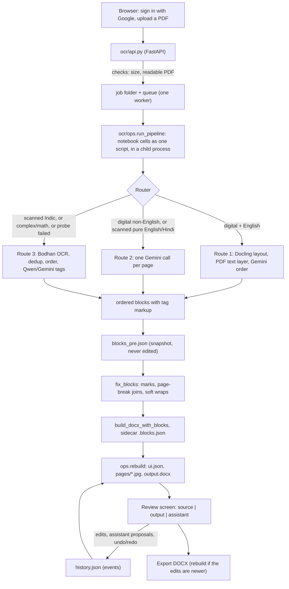

# Infinite OCR: pipeline methodology

How a PDF becomes an editable Word file, stage by stage. Everything here was read from the code in this repository; file and function names are real. Where a statement could not be checked (it needs a paid model, a Windows server or a browser) it is marked **[not run]**.

Contents: [1 Architecture](#1-architecture) · [2 Execution model](#2-execution-model) · [3 Stages](#3-stages) · [4 Review layer](#4-review-and-editing-layer) · [5 Models and services](#5-models-and-external-services) · [6 Dependencies](#6-dependencies) · [7 Configuration](#7-configuration-reference) · [8 Validation and errors](#8-validation-and-error-handling) · [9 Design decisions](#9-design-decisions) · [10 Tests](#10-tests) · [11 Known limits](#11-known-limits)

## 1. Architecture

Two layers. The **pipeline** (the stage files in `pipeline/`, one per cell of `pipeline/infinite_ocr.ipynb`, cut from it unchanged; the notebook stays as the reference and is not run by the app) holds all pipeline logic. The **app** (`ocr/` and the screen in `web_src/`) runs the pipeline on uploaded PDFs, stores the result, and lets people review and correct it.

## 2. Execution model

**One stage file per role.** `pipeline/runtime.py` maps each role (`config`, `metrics`, `helpers`, `grammar`, `utils`, `docx_a`, `docx_b`, `fixers`, `router`, `digital`, `single`, `indic_ocr`, `indic_fmt`, `final`) to a file (`stage_config.py`, `stage_metrics.py`, … `stage_final.py`). Each holds the code of one notebook cell unchanged; they are not modules: they are run in order in one shared namespace, as the notebook runs its cells. A missing file raises `PipelineError("pipeline changed: ...")` instead of running the wrong code. (`runtime.py` replaces the old `ocr/nb.py`, which read the notebook.) `tests/test_core.py` checks that every stage file still equals its notebook cell.

**Two edits to the stage text at run time**, nothing else (`runtime.patch_input`): `PDF_PATH` becomes `Path(os.environ["OCR_PDF"])` and `PAGES` becomes `-1` (all pages). Because the app sets `PAGES = -1`, `FORCE_ROUTE` and `PAGES` can only be changed by editing the stage files (`stage_config.py`).

**Pipeline run** (`ops.run_pipeline`): `runtime.run_script()` joins the `PIPELINE` roles in order, adds `SNAPSHOT_HOOK` (writes `blocks_pre.json` just before the final stage) and the `final` stage, and writes it to `pipeline_script.py` in the job folder. It runs as `python -u pipeline_script.py` in a child process with `cwd` = job folder, `OCR_PDF` set, output to `run.log`, timeout `JOB_TIMEOUT` (3600 s). Non-zero exit becomes `RuntimeError("pipeline failed - see run.log")`.

**Other operations** (`rebuild`, `review`, `newbox`, `assist`) also run in a short-lived child process: `python -m ocr.ops <op> <job_dir> <request.json> <result.json>`. The notebook keeps state in globals (one PDF, one set of counters), so jobs cannot share a process. The result file is `{"ok": true, "result": ...}` or `{"ok": false, "error": ...}`; a missing result file means "operation crashed - see ops.log". Measured overhead of a child process with the toolkit loaded is about 0.4 s **(verified on Linux)**; the wait for an assistant answer is the model call.

**Queue.** `api._worker` is one thread taking job ids from a queue: one pipeline run at a time (the notebook already uses threads for its model calls). States in `status.json`: `queued` → `running` → `finalizing` → `done` | `error`. At startup, jobs left `queued` are re-queued and jobs left `running`/`finalizing` are marked `error: server restarted while this job was running`.

**Job folder** (`ocr/store.py`; plain JSON, atomic writes via temp file + `os.replace`, no database):

| Path (under `data/jobs/<id>/`) | Written by | Content |
|---|---|---|
| `input.pdf` | upload | the PDF |
| `status.json` | api / worker | state, owner (Google `sub`), owner_email, filename, pages, timestamps, `built_rev`, error |
| `pipeline_script.py`, `run.log` | `run_pipeline` | the generated script and its output |
| `compare_out/infinite_ocr/` | notebook | `input__<route>.docx`, `input__<route>.blocks.json`, `crops/`, `pages/*_labeled.png`, retry images |
| `blocks_pre.json` | snapshot hook | `route`, `route_info`, `models`, `blocks` as the route produced them. Never edited. |
| `history.json` | api | `rev`, `cursor`, `events` (every edit since) |
| `ui.json` | `rebuild` | what the screen shows; `dir` keeps every block ever seen so undo is instant |
| `output.docx`, `pages/<n>.jpg` | `rebuild` | the latest Word file; page images at `DISPLAY_DPI` 110 |
| `proposals/<id>.json` | api | assistant results waiting for accept/reject (also where rejected requests are remembered, section 4) |
| `ops.log` | `ops.call` | output of rebuild / review / assist runs |

## 3. Stages

### Stage 0: Upload and validation (`api.upload`)
- **Input:** a PDF from a signed-in person. **Checks, in order:** size ≤ `MAX_UPLOAD_MB` (50) → 413; readable by PyMuPDF → 400. There is no page limit and no daily limit.
- **Processing:** `store.new_job` makes the folder, writes `input.pdf` and `status.json` (`queued`), and puts the id on the queue.
- **Output:** `{job_id, pages}`.

### Stage 1: Setup cells (always run)
Roles `config`, `metrics`, `helpers`, `grammar`, `utils`.
- **config:** imports; constants (`DPI` 200, `CHUNK_BLOCKS` 8, `FORCE_ROUTE` None); `MODEL_OPTIONS` + `CHOICE` → `M` (one model per step); worker counts (`ORDER_WORKERS`, `BODHAN_WORKERS`, `CHUNK_WORKERS` = 8); `GEMINI_THINK_TOKENS` 512; keys read from the environment (`OPENROUTER_API_KEY`, `BODHAN_OCR_API_KEY`); opens the PDF with PyMuPDF and builds `page_indices`. Raises if no valid page.
- **metrics:** wraps `requests.post`. Every call is appended to `CALLS` with method/stage (set by `set_stage`), model, tokens, cost, seconds. Adds `usage.include` for OpenRouter and the Gemini reasoning cap. Cost comes from OpenRouter's reply, else `PRICES_USD_PER_M`; Bodhan is `BODHAN_USD_PER_PAGE` 0.0024.
- **helpers:** `render_page`, `preprocess_page` (`original`, `gray`, `clahe_mild`), `sanitize` (strip HTML and LaTeX), furniture regexes, `_parse_json_object`.
- **grammar:** `TAG_GRAMMAR`, the one tag language every route ends in: `P`, `STYLE`, `BR`, `BLANK`, `LIST`/`ITEM`, `OPTIONS`/`OPTION`, `TABLE`/`ROW`/`CELL`, `QUESTION` (the builder also knows `RIGHT`, `IMG`, `FORMULA`, `SPAN`).
- **utils:** `_or_chat` (OpenRouter call: 5 tries, back-off 3/6/12/24/40 s + jitter on 429/5xx/network, HTTP 402 = credits exhausted, optional JSON mode), `_json_from`, `_img_uri`, `_x` (XML escape), a lock around PyMuPDF page access (the document is not thread-safe), `_mkblock`.

### Stage 2: Routing (`router` cell, `decide_route`)
- **Input:** the selected pages. **Digital test:** median characters per page of the text layer ≥ 120 **and** at least 60% of pages have ≥ 30 characters.
- **Digital:** share of ASCII letters ≥ 0.92 → `digital_english`, else `single_gemini`.
- **Scanned:** a probe sends up to 3 pages (spread evenly, 900 px, JPEG q70) to the `classify` model (Qwen3-VL 30B; falls back through `MODEL_OPTIONS["classify"]`) and asks for JSON: `scripts`, `has_math`, `numbers_heavy`, `complex_layout`.
  - complex layout **or** math/many digits → `scanned_indic` (`COMPLEX_BEATS_MATH`)
  - only English and/or Hindi → `single_gemini`
  - anything else → `scanned_indic`
  - probe failed on every model, or no OpenRouter key → `scanned_indic` ("probe unavailable")
- **Output:** `ROUTE`, `ROUTE_INFO` (kept in `blocks_pre.json`, shown as the pill on the review screen). `FORCE_ROUTE` overrides the decision.

| Route | Text comes from | Order comes from | Tags come from |
|---|---|---|---|
| `digital_english` | the PDF text layer | Gemini, per page | Python (deterministic) |
| `single_gemini` | Gemini reading the page image | Gemini, same call | Gemini, same call |
| `scanned_indic` | Bodhan OCR (Gemini/Qwen fallback) | Gemini, per page | Qwen/Gemini in chunks, with a text-fidelity check |

### Stage 3a: Route 1, digital English (`run_digital_english`)
1. **Layout:** Docling with its Heron layout model, OCR and table-structure switched off (`heron_layout`); one box + label per region (mapped by `_HERON_MAP`); thin tall boxes become `side_header`. Regions are sorted top-to-bottom as a neutral order; **[not run here: Docling is not installed in the test environment]**.
2. **Text:** `_read_region` reads each region from the PDF text layer (`page.get_text("dict", clip=rect)`): bold/italic/superscript from font flags and names, dominant font size, de-hyphenation across lines.
3. **Order:** per page, `_order_page` sends the region list (id, type, bbox, text or its first/last 150 characters) and a page image with labelled boxes to the `digital_order` model (Gemini 2.5 Flash, JSON mode, 5000 tokens). Unknown or duplicate ids are dropped, missing ids appended; on any failure the geometric order is kept. Pages run in parallel (`ORDER_WORKERS`).
4. **Page boundaries:** `_enforce_boundaries` moves a lower-case-starting page-first paragraph ahead of figures/headers, and a cut-off page-last paragraph after footnotes/footers. It acts only on that evidence.
5. **Markup, no model:** `_markup` builds `
`/`<LIST>` with heading level, alignment (centred if the box is centred and narrower than 80% of the page), size (if ≥ 1 pt from body size), bold/italic; tables via `page.find_tables` (`_table_markup`); pictures, formulas and tables that cannot be extracted are cropped to `compare_out/infinite_ocr/crops/*.png`; page headers/footers become empty blocks.
- **Output:** `ordered_blocks`, ids `p<page>_B<n>`.

### Stage 3b: Route 2, single Gemini call per page (`run_single_gemini`)
- **Input:** the page image (`_img_uri`, 1800 px). **Processing:** one call (`single_call`, Gemini 2.5 Flash, 300 s, 16000 tokens) with `SINGLE_PROMPT` = head + `TAG_GRAMMAR` + tail returns `<BLOCK id kind bbox>` elements in reading order.
- **Tolerant parsing:** `_split_blocks` accepts a missing `</BLOCK>`; `_split_bare` handles replies with tags but no wrappers; `_norm_bbox` accepts 0–1 or 0–1000; kinds are normalised (`_KIND_FIX`); pictures/figures/formulas with a box are cropped from the original render.
- **Retries:** if nothing parses, the page is re-sent as `gray`, `clahe_mild`, then `illum` (illumination-normalised) until one parses; if all fail the raw text is kept in one block. A page that raises becomes an empty `p<n>_failed` block, so one bad page never stops the run.
- Pages run in parallel (`ORDER_WORKERS`).

### Stage 3c: Route 3, scanned Indic (cells `indic_ocr`, `indic_fmt`)
1. **OCR (`_stage1_page`, per page, `BODHAN_WORKERS` in parallel):** `ocr_with_fallback` calls Bodhan `indic-ocr` (JPEG q92; up to 5 attempts; a 429 sets a shared cool-down so all workers pause). Blocks without text or picture type are dropped. If Bodhan fails or returns nothing usable, the same page goes to `_call_openrouter_ocr` (`ocr_fallback` model) with a JSON schema prompt that classifies scanner marks, page codes and "P.T.O." as page furniture.
2. **Dedup (`dedup_boxes`):** a box is dropped when it lies ≥ 95% inside a kept box, has IoU ≥ 0.3 with one, or ≥ 60% of its words appear in an overlapping kept box (informative, larger boxes are kept first). Each kept box gets a label `B<i>`; a coloured labelled copy of the page is saved to `pages/`; pictures are cropped to `crops/`.
3. **Order (`_order_all_pages`, per page):** `PLAN_PROMPT` + one line per block (`id | x0,y0,x1,y1 in % | type | text snippet`) + the labelled page image go to `indic_order` (Gemini 2.5 Flash). `_repair_order` makes the answer a permutation; the answer is rejected if more than 20% (`ORDER_BAD_FRAC`, at least 2) of ids had to be repaired. `_order_flags` finds consecutive same-column blocks where the next lies entirely above the previous (ignoring the last 3 positions and blocks the model marked `starts_mid`); if any, the model is asked once to re-check. Any failure keeps the detection order.
4. **Tags (`_format_chunk`):** blocks that have text (or are pictures) are sent in chunks of `CHUNK_BLOCKS` (8) with `COMBINED_PROMPT`, the block texts and the page images (800 px), to `indic_format`, chunks in parallel (`CHUNK_WORKERS`). The answer must contain only the words of the input:
   - **fidelity check** (`_chunk_faithful`): characters are compared as multisets (blank runs and `$` ignored); rejected if more than max(15, 10%) characters were dropped or more than max(25, 5%) were added;
   - on rejection the chunk is halved up to 3 times, then each block alone at temperature 0.3, then `_raw_fallback` (the OCR text wrapped in `
`/`<LIST>`/`<TABLE>`);
   - `<DROP>` is honoured only for scanner watermarks, "P.T.O."-type hints, and bare page numbers in the top/bottom 4% of the page (`_apply_drop_guard`);
   - model order inside a chunk is ignored: the planned order wins;
   - network guards: each call has a hard wall-clock limit (`CALL_DEADLINE` 300 s) and 5 attempts; 3 consecutive network-failed chunks trip a breaker and the rest use raw text.
5. **Check:** `_validate_final_order` prints whether the emitted order equals the plan (it logs; it does not stop the run). Blocks with empty text pass through as empty.
- **Cache:** `compare_out/infinite_ocr/<stem>__combined_cache.json` is keyed by prompt hash, model and chunk content, but the file is deleted at the start of every run, so it helps only within one run.

### Stage 4: Shared fixes (`fix_blocks`, cell `fixers`)
Run on the final ordered list for every route:
- `_attach_marks`: a bare marks token at the right margin (`8`, `1+7`, `[5]`) becomes `<RIGHT>…</RIGHT>` at the end of the question beside it.
- `_merge_pages_text`: a cut-off page-final paragraph plus a lower-case page-first paragraph become one paragraph (hyphen re-joined); the later block is emptied.
- `_merge_tables`: last table of page N and first of N+1 with the same column count and a repeated header row become one table.
- Soft-wrap join (`_join_soft_wraps`): ` ` that only wraps one sentence becomes a space.
- `_dedup_blocks` and `_attach_score_lines` are defined but **not called** by the active `fix_blocks`.

### Stage 5: DOCX build (`build_docx_with_blocks`, cells `docx_a`, `docx_b`)
- A tolerant tag parser (`_parse_markup`: unknown `<…>` stays text; a `
` opened inside an open `
` closes the first one, because the writer forgot `
`; the editor's parser in `web_src/src/markup/parse.ts` does the same) and renderers for paragraphs, runs, lists, option lists (a table when `layout` is grid/horizontal/inline), tables, blanks, right-flush marks, inline images and pictures (width from the source box, capped at the page).
- **Table cells** (`_fill_cell`): a cell holding only paragraphs, or only inline text, is written exactly as before. Any other cell (`_cell_is_complex`: options, a list, a question wrapper, or text/tags beside paragraphs) goes through `_fill_cell_blocks`, the general block renderer, so nothing is dropped: options are written one per paragraph whatever their layout, a heading becomes a plain paragraph. (Before this, options and lists next to a paragraph in a cell were silently left out of the Word file.) The editor mirrors the rule (`cell()` in `parse.ts`; a cell may hold paragraphs, lists, options and a nested table); `tests/test_markup_fidelity.py` compares the cells' contents, nested tables included.
- Maths: LaTeX → MathML (`latex2mathml`) → OMML (`mathml2omml`); on failure, plain text with real super/subscripts.
- Style: font `Nirmala UI`, 11 pt; a page break is inserted when a heading repeats an earlier heading (similarity ≥ 0.9, at least 12 characters) so a new paper starts on a new page.
- **Outputs:** `compare_out/infinite_ocr/input__<route>.docx` and `….blocks.json`: `pdf_path`, `docx_path`, `route`, `route_info`, `models`, `pages_processed`, `reading_order`, and per block `page`, `bbox`, `rendered`, `reason` (`empty_text_or_block`, `no_paragraphs_emitted`, `picture_error`). If the file is locked a time-stamped name is used.

### Stage 6: Finalise for the app (`ops.rebuild`, `api._worker`)
After the pipeline, `rebuild` replays `history.json` over `blocks_pre.json`, runs the final stage on that list, records which blocks were absorbed by page-break joins (parsed from the pipeline's own `fix:` log lines), writes `ui.json`, copies the Word file to `output.docx`, renders `pages/<n>.jpg`, and sets `built_rev`. The status becomes `done`.

### Stage 7: Export
`GET /api/jobs/<id>/download` rebuilds first if `history.rev` ≠ `built_rev`, then returns `output.docx` named after the uploaded file.

## 4. Review and editing layer

- **Events and undo** (`store.apply_event`): `set_fields` (editable: `formatted_text`, `is_picture`, `bodhan_type`, `bbox_norm`, `bbox_xyxy`, `merged_from`), `reorder` (within a page only), `add_block`, `delete` (never the last block), `batch`. `push` validates against the current blocks before appending and drops anything that was undone. The current document is always `blocks_pre.json` + `events[:cursor]`.
- **Instant view** (`store.light_doc`): the screen is built from saved edits alone (no notebook); the slow flags (page-break joins, Word file) are refreshed by a background `rebuild`.
- **The assistant** (`ops.assist`, prompt `assist.txt`): one box for any request about the selected blocks. It sends the selected blocks' tags and boxes, an outline of their pages, a crop of each block (≤ 8 crops, images ≤ 1100 px) and, only when the request needs it, the whole page (≤ 3 pages) to the assistant's model (`ASSIST_MODEL`, default `openai/gpt-4.1-mini`; if that setting is empty, the notebook's `classify` model), and reads `<REPLY>` and `<ACTION>` elements. `ops._scope` decides what is sent by keywords in the request: a request that is only about layout (centre, bold, table outline, list …) gets the block crops alone and its edits may not change any word (an edit that does is not offered); everything else (re-read, check, correct, merge, insert, delete, or anything unclear) gets the whole page too. The call is `ops._chat_fast`: it asks OpenRouter for its fastest provider (`provider.sort = throughput`; dropped if refused), waits at most 100 s for an answer, retries once after 2 s, and gives the answer room to write the blocks back (1500 + 2 tokens per character of tags, at most 8000); an answer that was cut off at that limit is an error, never a half answer. Each answer reports its own seconds and token use (shown on the card, and logged in `ops.log` with `prepare=` and `model=` times). Actions: **edit**, **merge**, **split**, **insert** (e.g. a table), **delete**. Nothing is applied: each action is a card with Compare, Accept, Reject.
  - *Ids* are matched without case or punctuation (`p1_B6`, `P1_b6`, `p1 · B6` are one block); a merged-away id is answered with "no longer exists: it was merged into …". A block's context says what happened to it in plain words (a merge names the new block and says the pieces no longer exist on their own).
  - *Removing a table outline is done in code, not by the model* (`_unwrap_outer`, `_unwrap_all` in `ocr/ops.py`): when the request names a table, an outline/border/grid and a removal, the answer is built without any model call. Rows and cells disappear, each cell's content stays in reading order (a header row stays bold), tables nested inside cells are kept unless the request says all/nested/inner, and the result is offered only if its words equal the original's. The model can choose the same operation with `<ACTION type="unwrap">` for other wording. Retyping a long table through a model was slow (about 30 s) and sometimes dropped a word.
  - *Replacement is an edit:* a reply that deletes one block and inserts a new one is turned into an edit of that block, so it keeps its box on the page. A picture or empty block can be read from its crop with an edit (the card says "read from image"). A reply that shows tags instead of a sentence is cleaned.
  - *Code checks:* ids must be selected blocks (insert anchors may be any block on those pages); tags must be balanced; a block is used by at most one action; pictures cannot be edited or merged; merge/edit word changes show a warning (merge compares words as a bag, so a left/right reorder is fine); unreadable answers are an error, not "no change".
  - *A merge makes one new block:* it gets a new id made from its pieces' ids (`p1_B1_B2`; unique, never confusable with another block's id, shortened when long) and takes the first piece's place; the pieces are removed. Its box is the union of the pieces that are on the first piece's page (`bbox_norm`, `bbox_xyxy`), and `merged_from` = the flat list of original pieces (id, page, box, tags, context). Merging an already merged block flattens, so the originals are never lost. Pieces on another page stay in `merged_from` and are sent as separate crops.
  - *Split* removes the merged block and restores `merged_from` as the original blocks, in order, in its place, each with its own context back plus what happened to the merged block since. It is refused if the block was not made by merging or an original id is taken.
  - *Side by side* pieces become one paragraph: left text, then the right text in `<RIGHT>…</RIGHT>`.
  - *Context, per block:* every accepted assistant request is stored on the block it changed, as a `context` entry (`eid`, time, what was asked, what the assistant said, what was done; the last 12 are kept). A merge adds its entry to every piece, and the new block's context is the pieces' contexts joined, oldest first, each entry once, so a follow-up on the new name sees both histories in order; a split gives each piece its own context back. The prompt shows each selected block's own context (the last 8 entries) plus the requests of the person REJECTED for it (from `proposals/`), and nothing about other blocks; merged blocks also show `parts=`. Context is part of the block's saved data, so Undo and Redo take it away and bring it back with the change.
  - *Accept* re-checks that the involved blocks are unchanged since the proposal (409 otherwise), computes ids and positions of new blocks at that moment, and pushes one `batch` event, so one Accept is one Undo.
- **API shortcuts** (`ops.review`, `ocr/intent.py`): `mode` `format` (words locked, uses the notebook's `_format_chunk` and its fidelity check), `reread` (crop → Bodhan → Qwen fallback → format), `delete`; and `newbox` (read a drawn box as a new block placed by its position). The screen no longer offers these separately; `python -m ocr.smoke` uses them.
- **Prompts** are files in `data/prompts/` (`assist.txt`, `fix_formatting.txt`, `default_instruction.txt`, `reread_hint.txt`), created on first use; a file missing a required placeholder falls back to the built-in text with a warning in `ops.log`.
- **Sign-in** (`ocr/auth.py`): the browser sends a Google ID token; the server verifies it against `GOOGLE_CLIENT_ID`, requires a verified email on `ALLOWED_EMAILS` (or `*`), and sets an HMAC-signed, `HttpOnly`, `Secure` cookie (`SESSION_HOURS`, default 168). People are identified by Google `sub`, never email. The signing key is `SESSION_SECRET` or a generated `data/secret.key`. Every job route checks `owner == sub`.

## 5. Models and external services

| Step | Default model (`CHOICE` index 0) | Used for |
|---|---|---|
| `classify` | `qwen/qwen3-vl-30b-a3b-instruct` | script probe; the API shortcuts (`ops.review_model`). The assistant uses `ASSIST_MODEL` instead (default `openai/gpt-4.1-mini`) |
| `digital_order` | `google/gemini-2.5-flash` | Route 1 reading order |
| `single_call` | `google/gemini-2.5-flash` | Route 2 |
| `indic_order` | `google/gemini-2.5-flash` | Route 3 page order |
| `indic_format` | `google/gemini-2.5-flash` | Route 3 tags (`COMBINED_MODELS`: the chosen model, then `google/gemini-2.5-flash` as a fallback when a different one is chosen) |
| `ocr_fallback` | `google/gemini-2.5-flash` | Route 3 when Bodhan fails (review replaces it with Qwen) |
| Bodhan `indic-ocr` | n/a | Route 3 OCR (`https://api.bodhan.ai/v1/chat/completions`) |

OpenRouter is `https://openrouter.ai/api/v1/chat/completions`. A model outside `MODEL_OPTIONS` is refused. The cost of every call is tallied in `CALLS` and shown per review proposal.

## 6. Dependencies

`requirements.txt` (unpinned): `fastapi`, `uvicorn`, `python-multipart`, `pydantic` (web server); `google-auth` (token check); `requests` (model calls); `pymupdf` (PDF text layer, rendering, tables); `opencv-python-headless`, `numpy`, `pillow` (images); `python-docx`, `latex2mathml`, `mathml2omml` (Word output); `docling` (Route 1 layout only, imported inside `heron_layout`). Dev: `pytest`, `httpx`. Screen (`web_src/package.json`): React 18, TipTap 3 (editor), KaTeX, zustand; build with Vite and TypeScript; tests with Vitest. No Jupyter is needed by the app; the notebook is read as JSON.

## 7. Configuration reference

Environment variables (`ocr/config.py`, `ocr/auth.py`): `OPENROUTER_API_KEY`, `BODHAN_OCR_API_KEY`, `GOOGLE_CLIENT_ID`, `ALLOWED_EMAILS`, `SESSION_SECRET`, `SESSION_HOURS` (168), `AUTH_DISABLED` (`1`), `MAX_UPLOAD_MB` (50), `JOB_TIMEOUT` (3600), `OP_TIMEOUT` (600), `ASSIST_MODEL` (default `openai/gpt-4.1-mini`), `ASSIST_MAX_TOKENS` (default: automatic), `OCR_DATA` (default `<repo>/data`). Constants in code: `DISPLAY_DPI` 110, `CROP_PAD` 0.01. Notebook knobs (edit the config and route cells): `DPI`, `CHUNK_BLOCKS`, `FORCE_ROUTE`, `MODEL_OPTIONS`/`CHOICE`, worker counts, `GEMINI_THINK_TOKENS`, router thresholds, fidelity tolerances (`FID_*`), `MAX_SPLIT_DEPTH`, `NET_FAIL_BREAKER`, `INSERT_PAGE_BREAKS`, `BREAK_ON_REPEATED_TITLE`.

## 8. Validation and error handling

| Where | Check | Result |
|---|---|---|
| upload | size, readable PDF | 413 / 400 with a readable message |
| stage files | every role has its file; INPUT lines found once | `PipelineError`, no pipeline run |
| config | at least one valid page | `ValueError` |
| model calls | retries, back-off, 402 credits message, hard wall-clock limit (Route 3) | retried, then falls back (see each route) |
| Route 1 / 3 order | repair to a permutation; reject if > 20% broken | detection/geometric order kept |
| Route 2 parse | tolerant splitting; preprocessed retries | raw text, or an empty `p<n>_failed` block |
| Route 3 tags | multiset fidelity + split-on-reject | raw OCR text for that chunk |
| pipeline process | exit code, `JOB_TIMEOUT`, missing `blocks_pre.json` | status `error` with a one-line reason; details in `run.log` |
| edits | block exists, fields allowed, order within page, id unused, never delete all | 400 |
| accept | blocks unchanged since proposal | 409 |
| assistant | see section 4 | skipped cards with reasons, or 422 |

A native crash of the Python process (seen once on the production server inside `docling_parse`, Windows Event Log `APPCRASH`, exception `0xc0000005`) leaves `run.log` without a traceback; the job shows only "pipeline failed - see run.log". Re-uploading the same file succeeded.

## 9. Design decisions

- **The stage files are the single copy of the pipeline that runs.** They are the notebook's cells, unchanged, one file each; the app runs them in order, patches two lines, and fails loudly if one is missing. The notebook stays beside them as the reference.
- **Child processes** because the pipeline's state is global (one PDF, one set of counters); one pipeline at a time because its model calls already run in threads.
- **Plain JSON files in one folder per job**: easy to inspect and back up; atomic writes avoid half-written files.
- **Events plus a snapshot** (`blocks_pre.json` + `history.json`) give undo/redo and a safe replay for every rebuild.
- **Text fidelity is enforced in code**, not trusted to the prompt (multiset check, drop guard, merge word comparison).
- **Every model answer has a fallback** (geometric order, raw OCR text, preprocessed retry) so a document always finishes.
- **Proposals, never silent edits:** the assistant only proposes; the person accepts.
- **Identity by Google `sub`; secrets only in environment variables or `data/`**, which is git-ignored.

## 10. Tests

`python -m pytest tests -q` (from the repo root): `test_core.py` (notebook roles, input patch, events/undo, review, prompts), `test_api.py` (sign-in rules, limits, delete, assistant: merge, split, insert, history), `test_pipeline.py` (the real notebook script end to end with a stand-in model, then `rebuild`, and the child-process protocol), `test_markup_fidelity.py` (the screen's editor must not change what the DOCX builder produces; needs `npm test` in `web_src` first). `npm test` in `web_src` has 54 tests. **Result on Linux, Python 3.12, Node 22: 132 Python tests and 65 screen tests pass.** `tests/test_builder_cells.py` proves that options, lists and text inside table cells reach the Word file. `tests/ui_server.py` + `tests/ui_check.py` (a browser walk-through with a stand-in model, needs Playwright and Chromium) **[not run]**. Nothing here calls a real model, Bodhan, Google, or runs on Windows.

## 11. Known limits

- `requirements.txt` is not pinned, so installs can differ over time.
- `FORCE_ROUTE` and the page selection are not reachable from the app.
- No job folder is ever deleted automatically.
- In Word, options inside a table cell are one paragraph each (no grid).
- The editor still shows a block as raw tags (with the reason above it) when its tags are shapes the Word builder flattens: a list or table inside a `
`, formatting inside `<RIGHT>`, a list inside a list, text beside the cells of a row.
- The Route 3 chunk cache is cleared at the start of each run.
- `_dedup_blocks` and `_attach_score_lines` in the notebook are unused.
- The assistant's quality depends on the Qwen3-VL 30B model; the code checks structure and words, not layout fidelity.
